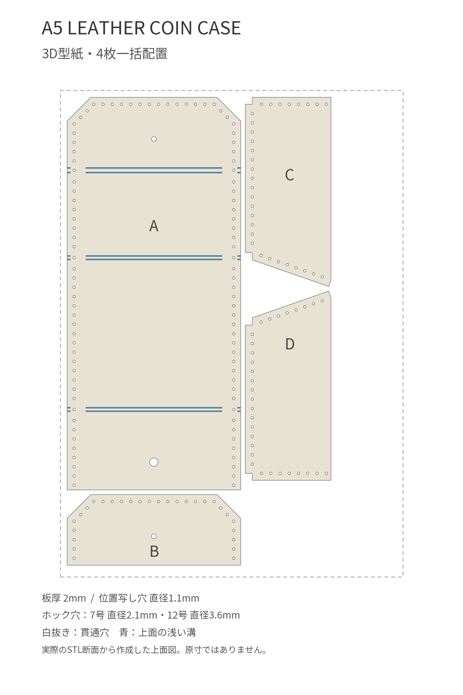

# A5 Leather Coin Case

英語正式名：**A5 Leather Coin Case**／日本語名：**A5サイズの革で作るコインケース**

A5（148×210mm）の革1枚から、本体・かぶせ裏・左右のマチを切り出して作るコインケースです。
縫い代3mm、菱目打ちの中心間4mmを基本にしています。

## ファイル

| 用途 | ファイル |
| --- | --- |
| 原寸型紙PDF（全4ページ） | [a5-leather-coin-case-pattern.pdf](pdf/a5-leather-coin-case-pattern.pdf) |
| A・本体の3D型紙 | [a-body-template.stl](3d/a-body-template.stl) |
| B・かぶせ裏の3D型紙 | [b-flap-liner-template.stl](3d/b-flap-liner-template.stl) |
| C・左マチの3D型紙 | [c-left-gusset-template.stl](3d/c-left-gusset-template.stl) |
| D・右マチの3D型紙 | [d-right-gusset-template.stl](3d/d-right-gusset-template.stl) |
| 4枚を配置した一括印刷用STL | [a5-leather-coin-case-templates.stl](3d/a5-leather-coin-case-templates.stl) |
| 編集用OpenSCAD | [a5-leather-coin-case-templates.scad](3d/a5-leather-coin-case-templates.scad) |
| 3D型紙の設定・使い方 | [3d/README.md](3d/README.md) |
| 共通形状データと生成元 | [source/README.md](source/README.md) |
| 数値検証結果 | [source/qa.json](source/qa.json) |

[PDFのプレビュー](images/pattern-preview.png)

## 材料と寸法

単位はmmです。表中の外形寸法は丸め表示で、PDF・STLには端数を含む確定座標を使っています。

| 項目 | 指定 |
| --- | --- |
| 革 | A5・1枚、厚さ1.0〜1.4 |
| A・本体の最大外形 | 約74.97×169.49 |
| B・かぶせ裏の最大外形 | 約74.97×30.49 |
| C・D・マチの最大外形 | 各 約81.67×37.00、左右対称 |
| かぶせの45度角落とし | 縦横 約10.24 |
| 縫い代 | 裁断線から穴中心まで3 |
| 菱目打ち | 中心間4。取付境界の丸錐前後は4.75／5 |
| マチの縫い線 | 底辺64・斜辺36・立ち上がり34 |
| A下端側のホック穴 | 12号・直径3.6、下端から中心まで12 |
| Aかぶせ側のホック穴 | 7号・直径2.1、先端から中心まで18。穴あけは任意 |
| Bのホック穴 | 7号・直径2.1、先端から中心まで18。Aのかぶせ側と中心を共有 |
| 3D型紙の基準 | P1S・0.4mmノズル、板厚2、位置写し用丸穴1.1 |

A5の裁断配置は、パーツ間2mm・革の外周3mm以上の余白を取っています。
厚みが出る場合はマチの縫い代を斜め漉きします。

## 型紙の見方と位置写し

- PDFは、裁断線が濃灰の実線、縫いガイド・穴中心が茶橙、取付位置が青の一点鎖線です。丸錐の位置は中心点を囲む丸で区別します。
- B・C・Dは同じページです。Aの取付境界にある丸錐穴には、本体だけを通す穴が含まれます。
- Aのかぶせ側の7号穴は任意です。ホックの取り付け方に応じて使います。
- 3D型紙で外周をケガき、小さい丸穴から穴中心を軽く写します。型紙を外してから革に本穴をあけます。
- Aの青い取付位置線は、3D型紙では上面の浅い溝に対応します。溝のない平らな下面を革に当てます。
- 3D型紙の大きな丸穴はホック用の2.1／3.6mmです。位置写し用1.1mmの穴と使い分けます。

## 検証状況

- 裁断輪郭・縫い穴中心は確定済みです。PDFと3Dは[共通の形状データ](source/geometry.json)から生成しています。
- PDFの原寸、線幅・色・線種、日本語フォントの埋め込み、ホック中心の一致を数値と表示で確認しています。
- STLは外形・厚さ・穴の中心と径・貫通・閉じた形状を確認しています。[検証結果](source/qa.json)に実データの値を記録しています。
- この改定型紙での実革試作と、今回の3D型紙の実機印刷はこれからです。
- 設計径1.1mmは、別途行ったP1S・0.4mmノズル・板厚2mmの試験片で採用した基準です。今回のSTL自体の実機検証済みという意味ではありません。

PDFは**A4・100%（実際のサイズ）**で印刷し、50mm確認線を実測してください。

[コインケースの一覧へ](../README.md) · [全作品の一覧へ](../../README.md)
