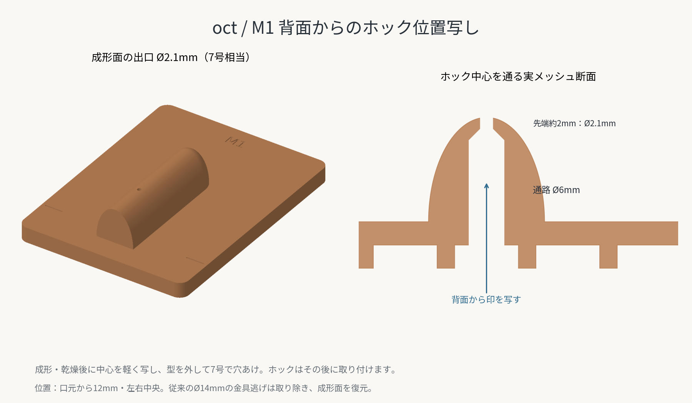
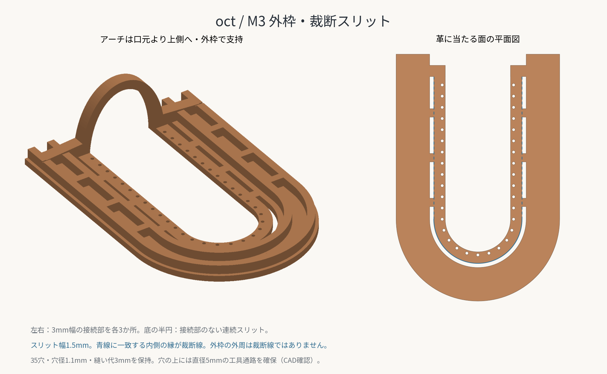

# Lip Balm Case — 3D Tools

リップクリームケースのPLA用治具です。Bambu Lab P1S・0.4mmノズル向けの試作データです。単位はmmです。

## ファイル

| ファイル | 用途 |
| --- | --- |
| [m1-lower-former.stl](m1-lower-former.stl) | 凸型・土台。背面からホック中心を写す通路付き |
| [m2-forming-frame.stl](m2-forming-frame.stl) | 成形時にクランプする幅広い上枠 |
| [m3-trimming-frame.stl](m3-trimming-frame.stl) | 外枠・裁断スリット・35穴を備える位置写し用上枠 |
| [a-rough-blank.stl](a-rough-blank.stl) | Aの90×120粗裁ち用。口元・ホック参考中心付き |
| [b-back-flap.stl](b-back-flap.stl) | Bの裁断・穴位置写し |
| [c-d-ring-tab.stl](c-d-ring-tab.stl) | Cの裁断・穴位置写し |
| [lip-balm-tools.scad](lip-balm-tools.scad) | 6部品の編集・再出力用OpenSCAD原稿 |

各STLは単独で印刷する向きです。G-codeは含みません。M1・M3の改訂に伴い、M2・A・B・CのSTLは変更していません。

## 共通の確定寸法

| 項目 | 値 |
| --- | --- |
| 革厚 | 1.0〜1.5 |
| 仕上がり裁断線から縫い穴中心まで | 3 |
| 縫い穴中心間 | 4。底も弧長でなく中心間の直線距離 |
| A・Bの主縫い穴 | 各35か所、共通座標 |
| 縫い・口元のガイド穴 | 設計径1.1、基準部の板厚2 |
| Aの本体側ホック | 7号・直径2.1 |
| Bのフラップ側ホック | 12号・直径3.6 |
| A粗裁ち／仕上がり投影外形 | 90×120／約31.570×66.785 |
| B全体／C | 約31.570×166.785／14×42・角R2 |

凸型は投影幅約19.970、膨らみ深さ18です。上枠開口には片側で革厚1.5＋余裕0.2を見ています。これらは試作値です。M3のガイド穴と内側開口の間は約0.55と細いため、強い成形荷重を掛けません。

## M1：成形後のホック中心を裏から写す

ホックは革絞り・乾燥後に取り付けます。中心は口元から12・左右中央で、STL上では土台の左上から45×32です。

- 背面から凸型内部を通る通路は直径6。先端で45度のテーパーを経て、成形面側の出口が7号相当の直径2.1になります。
- 先端ガイドの長さは中心軸上で2。凸型の曲面のため出口の縁では約1.9です。土台下面から成形面頂部までは26です。
- 従来の直径14・深さ3の金具逃げは取り除き、成形面を復元しました。成形前にホックを取り付ける使い方は前提にしていません。
- 革を型に載せたまま、背面から丸錐などの先端で中心を軽く写します。型を外してから7号で革に穴をあけ、ホックを取り付けます。型の中へハトメ抜きを打ち込む用途ではありません。

## M3：外枠・裁断スリット・縫い穴

細い内枠の外側に幅12の枠を追加し、左右の直線部で接続しました。内枠と外枠の間のスリットから裁断線を写します。

| 項目 | 値・使い方 |
| --- | --- |
| 裁断スリット幅 | 1.5。スリットの内側の縁が確定した裁断線 |
| 左右の接続部 | 各3か所、口元から13・29・45。接続部の幅3 |
| 底の半円 | 180度すべて連続スリット。接続部なし |
| 内枠と外枠の平板厚 | 2 |
| 外枠のリブ | 幅2.4・追加高さ3。通常の全高5 |
| アーチ | 奥行き4・壁厚3。口元より上側の-4〜0に配置 |
| アーチの支持 | 外枠へ向けた左右の広い足で支持。縫い穴上を通さない |
| M3の外形 | 約58.570×88.285。アーチを含む全高約22.7 |

外枠の外周は裁断線ではありません。左右は接続部を避けて破線状にケガき、型を外して定規でつなぎます。底は連続してケガけます。口元はアーチの本体側の面（y=0）に沿って写します。外枠の左右の短い溝も口元高さです。

35穴は設計径1.1・ガイドの板厚2を保持しています。穴より上に直径5の工具通路が空いていることをCAD断面で確認しています。以前の高い補強でアーチ付近の穴へ近づきにくかった点を、アーチ・支持部の配置変更で解消しました。

M3はケガキ・穴位置写し用です。成形時の強いクランプはM2で行います。

## 製作手順

1. Aを90×120で粗裁ちします。口元は上端から20、左右中央は45。ホックはまだ付けません。A型紙のホック印は参考位置です。
2. 湿らせた革をM1へ合わせ、M2の基準線を口元高さに揃えます。左右・底のクランプ座へ均等に力を掛け、乾燥させます。
3. 型と革を保持したまま、M1背面の通路からホック中心を軽く写します。
4. M2をM3へ交換し、口元を合わせます。下型で立体を支えながらスリットの内側の縁と、口元アーチの本体側の面をケガきます。
5. M3の35穴から縫い穴中心を軽く写します。型を外し、直線部のケガキの途切れを定規でつなぎます。
6. 裁断後、革に縫い穴と7号のホック穴をあけ、ホックを取り付けます。工具に合わせて内側から支えを入れ、成形済みの革を押し潰さないようにします。
7. Cを短く折り返してDカンを通し、Bへ横2列で縫い付けてから、AとBを縫い合わせます。B側の12号ホックは最長のリップを入れて最終位置を合わせます。

## 印刷と確認

以下は初回の出発点です。素材の温度・冷却は使用銘柄のP1Sプロファイルに合わせます。

| 部品 | 積層高さ | 壁・充填の目安 | サポート |
| --- | --- | --- | --- |
| M1・M2 | 0.2 | 壁4〜5周、上下5層以上、充填30〜40% | 原則不要。M1の裏面ポケット天井のブリッジを確認 |
| M3 | 0.2 | 壁4周、上下5層、充填30〜40% | アーチ下面のみ。ビルドプレートからのサポート |
| A・B・C | 0.2 | 壁3〜4周、上下5層 | 不要 |

- M1は土台裏をベッドに置きます。直径6から2.1へ縮む通路のテーパーを確認し、位置写し通路をサポートでふさがないようにします。
- M3は平らな面をベッドに置きます。サポートを外した後、アーチ内側とスリット・丸穴へ工具が届くことを確認します。
- 丸穴・スリットは位置写し用です。型を付けたまま穴あけ・裁断しません。
- 完全に冷めてから取り外し、平らな基準面で浮き・がたつきを確認します。使用後・翌日・数日後にも同じ置き方で確認してください。
- 今回のM1・M3はCAD上の寸法・接続・通路を確認済みです。今回の形状についてスライス・実機印刷・強度・経時変形は未検証です。

検証結果は[3d-qa.json](../source/3d-qa.json)、再確認は[check_3d_tools.py](../source/check_3d_tools.py)を参照してください。

## A・B・Cの目印

Aは90×120の粗裁ち、口元5穴（上端から20）とホック参考中心（45×32）を示します。ホック参考穴は7号・2.1ですが、成形前には革を打ち抜きません。

Bは主縫い穴35に加え、C用の横2列（口元から9・27）を示します。各列の中央3穴はCと共通、左右の端2穴はBだけに丸錐です。四隅の短いL字スリットはCの14×30の取付位置、フラップの「FIT」は12号ホックの仮位置です。

Cは横3・7・11、縦3・21・39の9穴です。先端から10のスリットは漉き範囲、12のスリットは折り返しです。12で短く返すと3の列が21へ重なります。

## 編集・再生成

OpenSCADの`part`を`M1`・`M2`・`M3`・`A`・`B`・`C`へ切り替えてF6でレンダーし、STLへ出力します。`assembly`と`layout`は確認用です。

- `snap_access_d`・`snap_mark_guide_t`：M1背面通路の径・先端ガイド長
- `stud_hole_d`・`socket_hole_d`：7号2.1・12号3.6
- `trim_slot_w`・`trim_outer_band`：M3のスリット幅・外枠幅
- `trim_bridge_y`・`trim_bridge_w`・`trim_bridge_overlap`：接続位置・幅・内外の重なり
- `trim_rib_h`・`trim_rib_w`：外枠の補強
- `arch_width_y`・`arch_wall`・`arch_root_h`：アーチと足の寸法
- `plate_t`・`guide_d`：位置写し部の板厚・丸穴径
- `forming_to_seam`・`mold_depth`・`leather_allowance`・`fit_clearance`：試作する凸型と上枠の逃げ

M3のスリット幅や補強を変えても、内側の裁断線と35穴の座標を維持します。凸型・開口を変更する場合は、内枠の最小肉厚を再確認してください。
