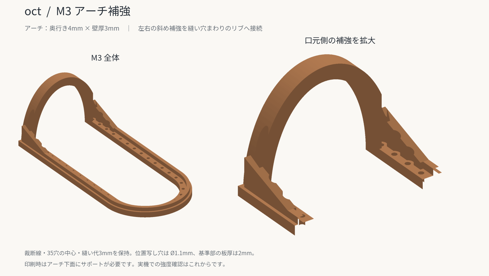

# Lip Balm Case — 3D Tools

リップクリームケースの3D型紙・革絞り治具です。

PLA・Bambu Lab P1S・0.4mmノズル向けの初回試作用です。寸法の単位はmmです。
確定したPDFの裁断輪郭と縫い穴中心を引き継いでいます。

## ファイル

| ファイル | 用途 |
| --- | --- |
| m1-lower-former.stl | 凸型と、裏面に格子リブを持つ下型土台 |
| m2-forming-frame.stl | クランプ用の幅広い成形用上枠。上面にリブと平らなクランプ座 |
| m3-trimming-frame.stl | Aの仕上げ裁断・縫い穴位置写し用の細い上枠。口元のアーチ付き |
| a-rough-blank.stl | Aの90×120mm粗裁ち用。口元基準とホック中心の位置写し |
| b-back-flap.stl | 背面兼フラップの裁断・穴位置写し |
| c-d-ring-tab.stl | Dカン留めの裁断・穴位置写し |
| lip-balm-tools.scad | 6部品を選択して編集・再出力できるOpenSCAD原稿 |

STLは各部品を単独で印刷する向きに配置済みです。実機用G-codeではありません。
まずM1・M2・M3を印刷して仮合わせし、実革で形状を確認する順番を推奨します。
A・B・Cは同時に用意してあります。

## 確定寸法と試作寸法

| 項目 | 値 |
| --- | --- |
| 革厚の想定範囲 | 1.0〜1.5 |
| 裁断線から縫い穴中心まで | 3 |
| 縫い穴中心間ピッチ | 4（底の曲線も中心間の直線距離） |
| A・Bで共通の主縫い穴 | 各35か所 |
| 縫い位置・口元基準のガイド穴 | 設計径1.1、基本板厚2 |
| Aのホック穴（オス側） | ハトメ抜き7号・設計径2.1 |
| Bのホック穴（メス側） | ハトメ抜き12号・設計径3.6 |
| A粗裁ち | 90×120 |
| A仕上がりの投影幅・高さ | 約31.570×66.785 |
| B全体の幅・高さ | 約31.570×166.785 |
| C | 14×42、角R2 |
| 凸型の投影幅 | 約19.970（試作値） |
| 凸型の膨らみ深さ | 18（試作値） |
| 下型から上枠開口までの片側の差 | 革厚分1.5＋余裕0.2 |
| 下型のホック裏金具用の逃げ | 設計径14、頂部から深さ3（暫定） |

凸型の幅だけ、以前の未製作の検討値約20.570から約19.970へ変更しました。
PDFの裁断線・穴位置を保ったまま、裁断枠のガイド穴と開口の間に約0.55の肉厚を残すためです。
円筒を収める断面の計算では、直径16を収められます。革の伸び・乾燥収縮・底の座りは実革で確認してください。

ホックの品番は固定していません。M2・M3は中央が開いており、ホック中心の周囲を覆いません。
M3の口元アーチは口元から4mmの範囲です。ホック中心は口元から12mmなので、アーチはホック中心の位置にはかかりません。斜め補強は左右の枠内へ配置しています。
金具逃げはM1だけに設けています。径14・深さ3は金具実寸を示す値ではなく、変更可能な余裕寸法です。
取り付けた革を下型に当て、裏金具が逃げの底や縁に当たらないことを確認してください。

## M3のアーチ補強

細かったアーチを太くし、左右の根元から縫い穴まわりの外側リブへ斜め補強をつなぎました。アーチだけへ力が集中することを抑えるための初回試作形状です。

| 項目 | 値 |
| --- | --- |
| アーチの奥行き（口元から） | 4（従来2） |
| アーチの壁厚（内側曲面から外側へ） | 3（従来2） |
| 左右の斜め補強 | 各幅1.8、口元から1〜14の範囲 |
| 斜め補強の根元の高さ | 基準面から8（平板2＋追加6） |
| 平板部／通常リブ部の高さ | 2／3.4 |
| アーチを含む部品全高 | 約22.7 |

裁断用の外縁、口元側のケガキ位置、アーチの内側曲面、35穴の中心と設計径1.1、縫い代3は保持しています。補強は開口の外側かつ裁断輪郭の内側です。

穴の基準部は板厚2・設計径1.1です。その上側には設計径2.3の工具逃げを全高まで設け、アーチや斜め補強が丸錐の進入をふさがない形にしています。2.3の部分は肉抜きや革の穴径ではありません。

STLは単一の閉じた立体で、35穴の位置・径と裁断外縁を確認済みです。高さ3.1の断面では、アーチの根元・斜め補強・U字のリブがひと続きになっています。穴中心から裁断線までのSTL上の距離は約2.995〜3.000で、曲線の多角形近似による差を含みます。

PrusaSlicer 2.7.2による参考スライス（ノズル0.4、積層0.2、線幅0.42、壁4周、上下5層、充填35%、ビルドプレートからのサポート）でも、根元の連続した経路と穴の開口を確認しました。P1Sの機械・銘柄別プロファイルの検証ではありません。実機印刷での強度・平面性は未検証です。

取り外し時はアーチだけを引っ張らず、左右の枠を持ってください。

## 印刷

以下は初回の出発点です。PLAの温度・冷却設定は使用銘柄のP1Sプロファイルに合わせます。

| 部品 | 積層ピッチの目安 | 壁・充填の目安 | サポート |
| --- | --- | --- | --- |
| M1・M2 | 0.2 | 壁4〜5周、上下5層以上、充填30〜40% | 原則不要 |
| M3 | 0.2 | 壁4周、2mmの平板部が十分に埋まる設定 | 口元アーチの下に必要。ビルドプレートからのみ |
| A・B・C | 0.2 | 壁3〜4周、上下5層ずつを目安 | 不要 |

- M1の底には、約11mm幅の開放ポケットがあります。格子リブを下にして印刷し、その上に平らなデッキを作る構造です。ポケット天井に短いブリッジが生じます。
- M2の上面の平らな座をクランプで押します。左右と底へ締め付けを分散してください。
- M3の下の面をベッドに置き、アーチは上向きです。サポートはアーチ内側に限定し、除去後に革へ当たる突起を整えます。
- A・B・CとM3の革に当たる基準面は平らです。リブは反対側にあります。小さい丸穴は型を外してから革に本穴をあけるための位置写し用です。
- 完全に冷えてから取り外し、常温で平面と仮合わせを確認します。リブはたわみを抑えるための構造で、PLAの経時変形を無くす保証ではありません。

## 革絞りと位置写し

1. Aの粗裁ち用型紙で90×120をケガきます。口元基準は上端から20、ホック中心は左端から45・上端から32です。
2. ホック中心を写し、7号（2.1mm）で革に穴をあけて取り付けます。Bのフラップ側は12号（3.6mm）です。型紙を外してから革を打ち抜きます。
3. 湿らせた革をM1へ合わせます。下型の左右の目印が口元高さです。裏金具を逃げへ収めます。
4. M2をかぶせ、革をなじませながら左右・底のクランプを均等に締めます。M2の左右の基準線は下型の口元高さに合わせます。
5. 乾燥して形が安定したら、下型を残したままM2を外し、M3へ交換します。M3の口元アーチを口元基準へ合わせます。
6. M3を革に保持したままM1を外します。M3の左右・底の外縁と、口元アーチの口元側の縁に沿ってケガきます。
7. M3の35個の丸穴から、丸錐などで穴中心を軽く写します。型の上から打ち抜く用途ではありません。
8. M3を外して裁断し、位置に合わせて革に穴をあけ、Bと縫い合わせます。

M3は細いガイド用枠です。M2の代わりに強くクランプして成形する用途には使いません。

## A・B・Cの目印

### A

- 大きな窓は軽量化と持ちやすさのためです。
- 上端から20mmの5つの丸穴は口元基準で、設計径1.1mmです。革を貫通させず、切り揃え位置の目印にします。
- 中央の上端から32mmの丸穴はホック用で、7号に対応する設計径2.1mmです。
- 穴径は革に当たる基準面側の寸法です。上面リブ部分には位置を写しやすくするため、少し大きな逃げを設けています。

### B

- 外周沿いの35穴はM3と同じ座標です。
- C取付けは、口元から下へ9・27の2列です。各列の中心3穴がCと共通、左右の端2穴はBだけに丸錐です。
- Bだけの穴の周囲には浅い円を刻みました。Cの左右端から外へ1mmの位置です。
- C取付け位置は14×30の長方形です。四隅の短いL字スリットから位置を写せます。
- フラップの「FIT」付近の丸穴は仮のホック中心で、12号に対応する設計径3.6mmです。最終位置は成形後、最長のリップを入れた状態で決めます。

### C

- 縫い穴は、横方向3・7・11、縦方向3・21・39の計9穴です。
- 先端側から10の短いスリットは漉き範囲、12のスリットは短い折り返しの目安です。
- 先端を斜め漉きし、12で短く返すと、3の列が21の列に重なります。
- 短いスリットは折り・漉きの位置写し用で、縫い穴ではありません。

## OpenSCADの変更

`part` を `M1` / `M2` / `M3` / `A` / `B` / `C` に切り替え、F6でレンダーしてSTLへ出力します。
`assembly` は確認用の分解配置、`layout` は全体確認用です。この2つは印刷用データとして一括出力しません。

主な調整項目は次のとおりです。

- `snap_relief_d` / `snap_relief_depth`：下型の裏金具逃げ
- `leather_allowance` / `fit_clearance`：革厚と上枠開口の余裕
- `forming_to_seam` / `mold_depth`：未確定の凸型の幅・深さ
- `plate_t` / `guide_d`：型紙の基本板厚と位置写し穴径
- `stud_hole_d` / `socket_hole_d`：Aの7号穴2.1mm／Bの12号穴3.6mm
- `template_rib_h` / `template_rib_w` / `template_ribs`：薄い型紙の上面補強
- `arch_width_y` / `arch_wall`：M3のアーチの奥行き・壁厚
- `arch_braces` / `arch_brace_w` / `arch_brace_h` / `arch_brace_run`：M3の斜め補強の有無・幅・根元の追加高さ・アーチ後端からの長さ
- `press_plate_t` / `press_rib_h` / `press_rib_w`：成形用枠の板厚と補強
- `base_t` / `base_pocket_depth`：下型の全厚と裏面ポケット深さ

上枠の開口を広げると、M3のガイド穴の内側が薄くなります。
原稿は最小肉厚0.45未満で出力を止めます。穴位置を勝手にずらさず、革厚・余裕・凸型寸法を見直すためのチェックです。
