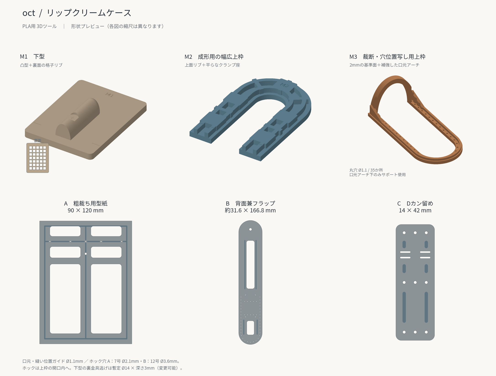

# Lip Balm Case

英語正式名：**Lip Balm Case**／日本語名：**リップクリームケース**

革絞りした前面A、背面兼フラップB、Dカン留めCで作るリップクリームケースです。AとBの左右・底を縫い合わせ、フラップをバネホックで留めます。前面の底は丸く成形します。

## ファイル

| 用途 | ファイル |
| --- | --- |
| 原寸の型紙PDF（表紙を含む4ページ） | [lip-balm-case-pattern.pdf](pdf/lip-balm-case-pattern.pdf) |
| 革絞り用の下型 | [m1-lower-former.stl](3d/m1-lower-former.stl) |
| 幅広い成形用上枠 | [m2-forming-frame.stl](3d/m2-forming-frame.stl) |
| 裁断・縫い穴位置写し用上枠 | [m3-trimming-frame.stl](3d/m3-trimming-frame.stl) |
| Aの粗裁ち用3D型紙 | [a-rough-blank.stl](3d/a-rough-blank.stl) |
| Bの3D型紙 | [b-back-flap.stl](3d/b-back-flap.stl) |
| Cの3D型紙 | [c-d-ring-tab.stl](3d/c-d-ring-tab.stl) |
| 6部品の編集・再出力用原稿 | [lip-balm-tools.scad](3d/lip-balm-tools.scad) |
| 3D治具の寸法・印刷・使用手順 | [3d/README.md](3d/README.md) |
| PDFの生成元・形状データ | [source/README.md](source/README.md) |

## 材料と寸法

単位はmmです。

| 項目 | 指定 |
| --- | --- |
| 革厚 | 1.0〜1.5 |
| 対象のリップクリーム | 長さ77・直径16／長さ83・直径15／長さ67・直径15 |
| 縫い代 | 裁断線から穴中心まで3 |
| 菱目打ち | 中心間4。底の曲線も中心間の直線距離を4にする |
| Aの粗裁ち | 90×120 |
| Aの仕上がり投影寸法 | 幅約31.570×高さ約66.785 |
| Bの全体寸法 | 幅約31.570×高さ約166.785 |
| C | 14×42、角R2、短い折り返し12 |
| Dカン | 内幅15程度を仮定。折り返しは実物に合わせる |
| Aの本体側ホック穴 | ハトメ抜き7号・直径2.1 |
| Bのフラップ側ホック穴 | ハトメ抜き12号・直径3.6 |
| 口元・縫い位置のガイド穴 | 設計径1.1 |
| 3Dプリント | PLA／Bambu Lab P1S／0.4mmノズル |

## 作り方の流れ

1. Aを余裕のある90×120で粗裁ちし、ホックを取り付けます。口元基準は上端から20、ホック中心は左端から45・上端から32です。
2. 湿らせたAをM1へ合わせ、M2で左右・底を押さえてクランプします。M1にはホック裏金具の逃げがあります。
3. 乾燥後にM2をM3へ交換し、外周と口元をケガき、縫い穴中心を写します。位置写しは下型で立体を支えた状態でも行えます。
4. 型を外してAを裁断・穴あけします。Cの先端を斜め漉きし、短く折り返してDカンを通します。Bへの取付けは横縫い2列で、各列の両端はBだけに丸錐で穴をあけます。Cの取付け長方形の上端はAの口元高さに揃えます。
5. CをBへ縫い付けてから、AとBを縫い合わせます。
6. 成形後の厚みを見ながら、最長のリップクリームを入れてB側ホックの最終位置を合わせます。

口元の1.1mm穴は裁断位置の目印です。革を貫通させる用途ではありません。位置写し用の型紙の上から、ハトメ抜きや菱目打ちを打ち込みません。

## 検証状況

- PDFの裁断形状・縫い穴配置は確定済みです。Bのフラップ側ホック中心は、成形後に合わせるための仮位置です。
- STLはデータ上の寸法、穴径・中心位置、閉じた形状を確認済みです。
- M3は口元アーチを奥行き4・壁厚3へ太くし、左右の斜め補強で縫い穴まわりのリブにつなぎました。裁断外縁と35穴の位置は引き継いでいます。詳細は[3Dの説明](3d/README.md#m3のアーチ補強)を参照してください。
- 6部品を使った実機印刷・革絞りによる確認はこれからです。凸型の寸法、革厚の逃げ、ホック裏金具の逃げは初回試作で調整します。
- 位置写し穴の標準径1.1mmは、別途実施したP1S・0.4mmノズル・板厚2mmの試験片の結果を採用しています。

PDFはA4・100%で印刷し、各パーツページの50mm確認線で倍率を確認してください。

[小物の一覧へ](../README.md) · [全作品の一覧へ](../../README.md)
